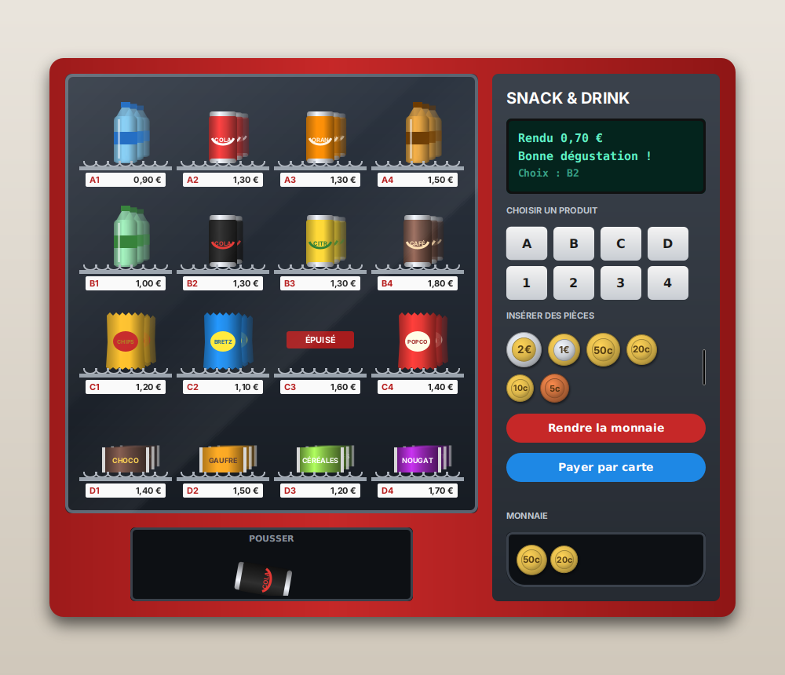

# Distributeur de boissons

Un distributeur automatique en JavaFX : on insère des pièces (ou on paie par carte), on tape le code d'un produit (par exemple `B2`), le produit tombe et la monnaie est rendue.

Le code compile et l'application se lance… mais elle n'a **aucun test**, et elle contient **19 bugs**. Votre mission : les trouver en écrivant des tests, puis les corriger.

> **Règle d'or : pas de correction sans test rouge.**
> Pour chaque bug : 1) écrivez un test qui échoue, commit `BUG: …` ; 2) corrigez, le test passe, commit `FIX: …`.

## Démarrage

Prérequis : Java 21, Maven 3.9, un IDE.

| Commande | Effet |
| --- | --- |
| `mvn javafx:run` | Lance l'application |
| `mvn javafx:run -Dmaintenance=true` | Lance l'application avec le panneau de maintenance ouvert |
| `mvn test` | Lance les tests et produit le rapport de couverture `target/site/jacoco/index.html` |
| `mvn test -Dtest=SlotTest` | Lance une seule classe de test |
| `mvn test-compile org.pitest:pitest-maven:mutationCoverage` | Tests de mutation, rapport dans `target/pit-reports/index.html` |

Depuis un IDE, lancez `fr.tp.vending.Launcher`. Un premier test est fourni : `MoneyTest`.

### Le mode maintenance

**Ctrl+M** (**Cmd+M** sur Mac) ouvre ou ferme le panneau du technicien, à droite de la fenêtre. Il donne accès à ce que le client ne voit pas :

- **Horloge** : régler une heure simulée (par exemple `14:00:00`) pour essayer la happy hour à n'importe quel moment ;
- **Lecteur de carte** : faire accepter ou refuser le paiement, et voir le dernier montant débité ;
- **Caisse** : voir et modifier le nombre de pièces de chaque sorte dans la machine ;
- **Ventes** : le chiffre d'affaires et le nombre de ventes par spirale ;
- **Réapprovisionner** une spirale ;
- **Saisie libre du code** : taper un code au clavier (`b2`, ` B2 `…) au lieu d'utiliser le pavé ;
- **Changer un produit** : mettre un autre produit (nom et prix) dans une spirale.

Pratique pour reproduire à la main un bug trouvé par un test… mais ce sont vos tests qui doivent le prouver.

## Le code

Tout ce qui est à tester est dans `fr.tp.vending.model`, en Java pur (sans JavaFX). Le paquet `fr.tp.vending.ui` est la fenêtre : inutile de le tester.

| Classe | Rôle | Dépendances à isoler |
| --- | --- | --- |
| `Money` | Affiche un montant en centimes (`130` → `"1,30 €"`) | aucune |
| `Coin` | Les pièces acceptées : 2 €, 1 €, 50c, 20c, 10c, 5c | aucune |
| `Product` | Un produit et son prix | aucune |
| `Slot` | Une spirale du distributeur (`"B2"`), son produit et sa quantité | aucune |
| `ChangeCalculator` | Calcule les pièces à rendre | aucune |
| `Pricing` | Le prix réellement payé (happy hour) | l'horloge (`java.time.Clock`) |
| `VendingMachine` | Le distributeur : crédit, achats, carte, annulation, stock, ventes | `Display`, `CoinDispenser`, `ProductDispenser`, `CardTerminal` (du matériel : à remplacer par des mocks), `ChangeCalculator`, `Pricing` |

Tous les montants sont des `int` en **centimes**.

## Le cahier des charges

### Montants (`Money`)
- `Money.format` affiche les euros, une virgule, puis toujours deux chiffres pour les centimes, puis ` €` : `5` → `"0,05 €"`, `1000` → `"10,00 €"`.
- Un montant négatif s'affiche avec un signe moins devant : `-5` → `"-0,05 €"`, `-130` → `"-1,30 €"`.

### Produits (`Product`)
- Un produit a un nom non vide (ni `null`, ni vide, ni uniquement des espaces).
- Son prix est strictement positif et multiple de 5 centimes.
- Sinon, le constructeur lève une `IllegalArgumentException`.

### Spirales (`Slot`)
- Une spirale contient entre 0 et `Slot.CAPACITY` (10) produits. Hors de ces bornes, le constructeur lève une `IllegalArgumentException`.
- Elle est vide quand sa quantité vaut 0.
- `restock(n)` ajoute `n` produits (`n` > 0, sinon `IllegalArgumentException`). Si la spirale dépasserait la capacité, `restock` lève une `IllegalStateException` **et ne change rien**.

### Rendu de monnaie (`ChangeCalculator`)
- `compute(montant, piècesDisponibles)` rend **exactement** le montant, **avec le moins de pièces possible**, en n'utilisant que les pièces disponibles.
- S'il existe une façon de rendre le montant, il doit la trouver. Exemple : rendre 60c avec une pièce de 50c et trois de 20c → trois pièces de 20c.
- S'il n'y a aucune façon de rendre le montant, le résultat est `Optional.empty()`.
- Rendre 0 donne une map vide. Un montant négatif lève une `IllegalArgumentException`.

### Happy hour (`Pricing`)
- De **14:00 à 15:59** (14:00:00 inclus, 16:00:00 exclu), les prix sont réduits de 20 %.
- Le prix réduit est arrondi aux **5 centimes les plus proches** : 1,30 € → 1,04 € → **1,05 €** ; 1,10 € → 0,88 € → **0,90 €**.
- En dehors de ces heures, on paie le prix normal.

### Le distributeur (`VendingMachine`)

**Au démarrage**, l'écran affiche `"Bonjour !"` / `"Insérez des pièces"`.

**Insérer une pièce** (`insert`)
- Le crédit augmente de la valeur de la pièce, la pièce rejoint la caisse, l'écran affiche `"Crédit"` / le crédit.
- Le crédit ne peut pas dépasser `MAX_CREDIT` (5,00 €), mais il peut l'atteindre exactement. Une pièce qui ferait dépasser est rendue aussitôt (`CoinDispenser.dispense(pièce, 1)`) et l'écran affiche `"Crédit maximum"` / `"5,00 €"`.

**Acheter avec des pièces** (`select`)
- Les codes ne tiennent pas compte de la casse ni des espaces autour : `" b2 "` est `B2`.
- Code inconnu : l'écran affiche `"Code inconnu"` / le code. Spirale vide : `"<code> épuisé"` / `"Autre choix ?"`. Rien n'est vendu.
- Le prix est celui donné par `Pricing` (donc réduit en happy hour).
- Crédit insuffisant : l'écran affiche le nom du produit / `"Prix <prix>"`, rien n'est vendu, le crédit est conservé. **Un crédit égal au prix suffit.**
- Si la monnaie ne peut pas être rendue : `"Pas de monnaie"` / `"Faites l'appoint"`, rien n'est vendu, le crédit est conservé.
- Sinon : le produit tombe (`ProductDispenser.release`), la quantité diminue de 1, la monnaie est rendue (un appel à `CoinDispenser.dispense` par sorte de pièce, jamais avec 0 pièce), les pièces rendues **sortent de la caisse**, l'écran affiche `"Rendu <monnaie rendue>"` / `"Bonne dégustation !"`, et le crédit revient à 0.

**Payer par carte** (`payByCard`)
- Seulement quand le crédit est à 0. Sinon : `"Pièces insérées"` / `"Choisissez avec le crédit"`, et le terminal n'est pas sollicité.
- Mêmes vérifications de code et de stock que pour `select` (et le terminal n'est pas sollicité).
- Le terminal est débité du prix donné par `Pricing`. **Si le paiement est refusé, rien n'est vendu** : `"Carte refusée"` / `"Autre moyen ?"`.
- Si le paiement est accepté : le produit tombe, la quantité diminue, l'écran affiche `"Paiement accepté"` / `"Bonne dégustation !"`.

**Annuler** (`cancel`)
- Sans crédit, il ne se passe rien (aucun appel au matériel, pas même à l'écran).
- Sinon, tout le crédit est rendu, le crédit revient à 0 et l'écran réaffiche le message d'accueil.
- Si la monnaie ne peut pas être rendue, **le crédit est conservé** et l'écran affiche `"Pas de monnaie"` / `"Choisissez un produit"`.

**Statistiques et stock**
- `revenue()` est le total des **prix payés** (pièces et carte confondues). `salesOf(code)` est le nombre de ventes d'une spirale (code insensible à la casse).
- `restock(code, n)` réapprovisionne une spirale (code insensible à la casse) ; un code inconnu lève une `IllegalArgumentException`.

**Maintenance**
- `replaceProduct(code, produit)` met un autre produit dans une spirale (code insensible à la casse) ; la quantité ne change pas. Un code inconnu lève une `IllegalArgumentException`.
- `setCoins(pièce, n)` fixe le nombre de pièces d'une sorte dans la caisse. Un nombre négatif lève une `IllegalArgumentException` et ne change rien.

## Pour aller plus loin

- **Tests paramétrés** : `ChangeCalculator`, `Pricing` et `Money` se prêtent bien à `@CsvSource`.
- **Mocks** : vérifiez avec Mockito ce que le distributeur demande au matériel (`verify`, `verifyNoInteractions`). Pour tester l'heure, construisez `Pricing` avec `Clock.fixed(...)`.
- **Mutation** : quand tous vos tests passent, lancez PIT. Chaque mutant survivant est un test qui manque… ou presque toujours.
