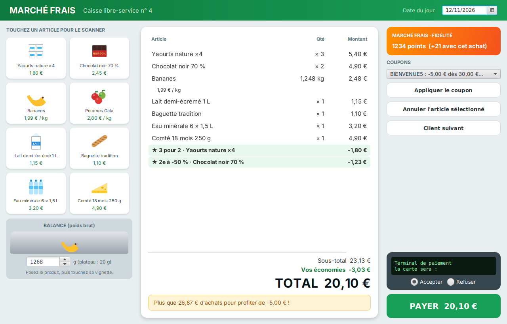
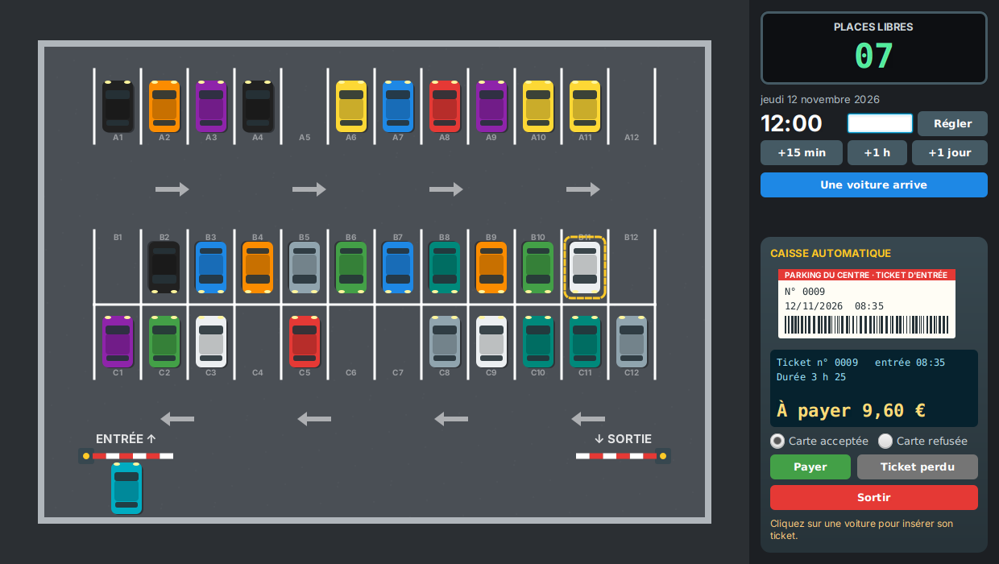

# Tests unitaires : deux projets à tester

Deux applications JavaFX qui fonctionnent… à peu près. Elles n'ont **aucun test**, et chacune cache des bugs. Votre mission, sur **les deux projets** : écrire les tests qui prouvent chaque bug, puis le corriger.

| Projet | Ce que c'est | Bugs | Sujet |
| --- | --- | --- | --- |
| [Caisse automatique](caisse/) | La caisse libre-service d'un supermarché : scan, balance, promotions, coupons, carte fidélité, paiement | **24** | [caisse/README.md](caisse/README.md) |
| [Parking](parking/) | Un parking à barrières : tickets, tarif jour/nuit, plafond journalier, caisse, sortie | **19** | [parking/README.md](parking/README.md) |

<p align="center">
  
  
</p>

## Démarrage

Prérequis : Java 21, Maven 3.9, Git, un IDE (IntelliJ IDEA, VS Code ou Eclipse).

```
git clone <url de ce dépôt>
cd unittesting/caisse      # ou unittesting/parking
mvn javafx:run             # lance l'application
mvn test                   # lance les tests
```

Chaque dossier est un projet Maven indépendant : ouvrez-le tel quel dans votre IDE.

## La méthode

> **Règle d'or : pas de correction sans test rouge.**
> Pour chaque bug : 1) écrivez un test qui échoue, commit `BUG: …` ; 2) corrigez, le test passe, commit `FIX: …`.

Le sujet de chaque projet contient un **cahier des charges** : c'est lui qui dit ce que le code doit faire. Les bugs se trouvent en le comparant au comportement réel, test après test.

Vous aurez besoin de :

- **JUnit 5**, y compris les **tests paramétrés** (`@ParameterizedTest`, `@CsvSource`) ;
- **AssertJ** pour des assertions lisibles ;
- **Mockito** pour remplacer le matériel (balance, terminal de paiement, imprimante, barrières) et vérifier ce que le code lui demande ;
- une **horloge contrôlée** (`java.time.Clock`) pour tout ce qui dépend de la date ou de l'heure ;
- **JaCoCo** (couverture) et **PIT** (tests de mutation), déjà configurés dans chaque `pom.xml`.

Certains bugs se voient en cliquant dans l'application, d'autres seulement avec un test. Ne vous arrêtez pas quand l'application « a l'air de marcher » : arrêtez-vous quand tous les bugs annoncés sont prouvés et corrigés.
