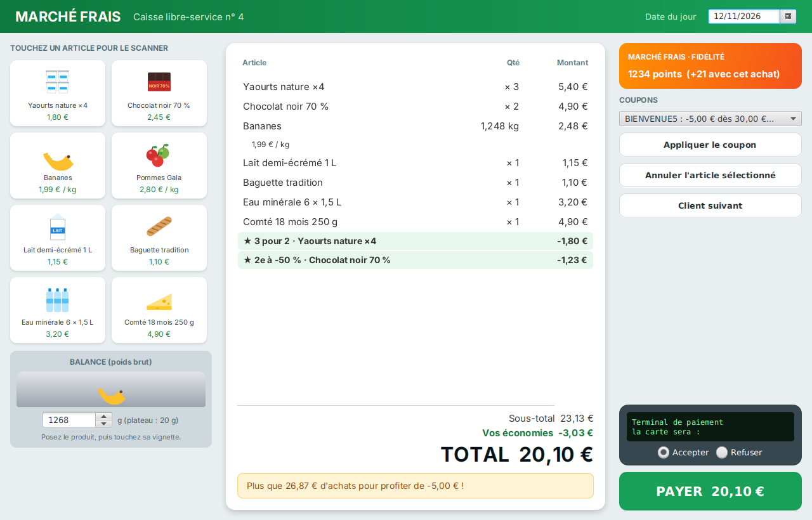

# Caisse automatique

La caisse libre-service d'un supermarché : on scanne ses articles, on pèse les fruits, les promotions s'appliquent, on utilise sa carte fidélité et ses coupons, puis on paie par carte.

Le code compile et l'application se lance… mais elle n'a **aucun test**, et elle contient **24 bugs**. Votre mission : les trouver en écrivant des tests, puis les corriger.

> **Règle d'or : pas de correction sans test rouge.**
> Pour chaque bug : 1) écrivez un test qui échoue, commit `BUG: …` ; 2) corrigez, le test passe, commit `FIX: …`.

## Démarrage

Prérequis : Java 21, Maven 3.9, un IDE. Toutes les commandes se lancent **dans le dossier `caisse`**.

| Commande | Effet |
| --- | --- |
| `mvn javafx:run` | Lance l'application |
| `mvn test` | Lance les tests et produit le rapport de couverture `target/site/jacoco/index.html` |
| `mvn test -Dtest=CheckoutTest` | Lance une seule classe de test |
| `mvn test-compile org.pitest:pitest-maven:mutationCoverage` | Tests de mutation, rapport dans `target/pit-reports/index.html` |

Depuis un IDE, lancez `fr.tp.checkout.Launcher`. Un premier test est fourni : `MoneyTest`.

### L'application

- Touchez une vignette pour **scanner** l'article. Pour un fruit, réglez d'abord le poids sur la **balance** (poids brut, plateau compris).
- Touchez une ligne du ticket pour la sélectionner, puis **Annuler l'article sélectionné**.
- Touchez la **carte fidélité** pour la scanner. Choisissez un **coupon** dans la liste et appliquez-le.
- Le **terminal de paiement** peut accepter ou refuser la carte. **Payer** imprime le ticket de caisse.
- La **date du jour** (en haut à droite) se règle, pour essayer les dates d'expiration des coupons.

## Le code

Tout ce qui est à tester est dans `fr.tp.checkout.model`, en Java pur (sans JavaFX). Le paquet `fr.tp.checkout.ui` est la fenêtre : inutile de le tester.

| Classe | Rôle | Dépendances à isoler |
| --- | --- | --- |
| `Money` | Affiche un montant en centimes (`130` → `"1,30 €"`) | aucune |
| `Product` | Un article : code-barres, nom, prix (à l'unité ou au kilo) | aucune |
| `Line` | Une ligne du ticket et son montant | aucune |
| `ThreeForTwo`, `SecondHalfPrice`, `ThresholdDiscount` | Les promotions (interface `Promotion`) | aucune |
| `Coupon` | Un bon de réduction | aucune |
| `InMemoryCatalogue` | Un catalogue en mémoire (interface `Catalogue`) | aucune |
| `Checkout` | La caisse : scan, annulation, remises, coupons, points, paiement | `Catalogue`, `Scale`, `PaymentTerminal`, `ReceiptPrinter` (à remplacer par des mocks), `Clock` |

Tous les montants sont des `int` en **centimes**. Les classes `Line` et certaines méthodes ne sont visibles que dans le paquet : placez vos tests dans le même paquet, `fr.tp.checkout.model`, sous `src/test/java`.

## Le cahier des charges

### Montants (`Money`)
- `Money.format` affiche les euros, une virgule, deux chiffres de centimes, puis ` €` : `5` → `"0,05 €"`, `2133` → `"21,33 €"`.
- Un montant négatif s'affiche avec un signe moins : `-180` → `"-1,80 €"`.

### Articles (`Product`)
- Un article a un code et un nom non vides (ni `null`, ni vides, ni blancs), et un prix strictement positif. Sinon : `IllegalArgumentException`.
- Le prix est à l'unité, ou au kilo si `byWeight` vaut `true`.

### Lignes (`Line`)
- Article à l'unité : prix × quantité.
- Article au poids : prix au kilo × poids, **arrondi au centime le plus proche** (un demi-centime s'arrondit au-dessus). Exemple : 1,99 €/kg × 1,248 kg = 2,48352 € → **2,48 €** ; 1,99 €/kg × 1,250 kg = 2,4875 € → **2,49 €**.

### Scanner (`Checkout.scan`)
- Un code inconnu du catalogue lève une `IllegalArgumentException`.
- Les unités d'un même article vont **sur la même ligne**, quel que soit l'ordre de scan (yaourt, lait, yaourt → une ligne « yaourt × 2 » et une ligne « lait × 1 »).
- Un article au poids lit la balance. La balance donne le poids **brut** : il faut retirer le plateau, `Checkout.TRAY_GRAMS` (20 g). Si le poids net est nul ou négatif : `IllegalStateException`, rien n'est ajouté. Chaque pesée fait une nouvelle ligne.

### Annuler (`Checkout.cancel`)
- Annule **une unité** de l'article. Une ligne qui tombe à 0 disparaît. Pour un article au poids, annule sa dernière pesée.
- Annuler un article absent du panier lève une `IllegalArgumentException`.

### Promotions
- **3 pour 2** (`ThreeForTwo`) : pour chaque groupe complet de 3 unités, une est offerte. 5 unités → 1 offerte ; 6 unités → 2 offertes.
- **2e à -50 %** (`SecondHalfPrice`) : pour chaque paire, la seconde unité est à moitié prix, **arrondi au centime supérieur** (moitié de 2,45 € → 1,23 €). 3 unités → une seule paire.
- **-5 € dès 50 €** (`ThresholdDiscount`) : si le **sous-total, avant toute remise**, atteint 50,00 € (inclus).
- Les promotions ne concernent que les articles à l'unité.

### Coupons (`Checkout.applyCoupon`)
- Renvoie `true` si le coupon est accepté, `false` sinon.
- Un coupon est valable **jusqu'à sa date d'expiration incluse** (la date du jour vient de l'horloge `Clock`).
- Le sous-total doit atteindre le minimum d'achat du coupon (inclus).
- Un même code ne peut servir qu'une fois par panier.

### Total et points
- `discounts()` : les promotions dans l'ordre, puis les coupons. `total()` = sous-total − remises, **jamais négatif**.
- `pointsEarned()` : **un point par euro entamé du total** (0 € → 0 point ; 0,01 € à 1,00 € → 1 point ; 3,65 € → 4 points).

### Payer (`Checkout.pay`)
- Panier vide : `IllegalStateException`, le terminal n'est pas sollicité.
- Le terminal est débité du **total** (remises comprises).
- Paiement **refusé** : `pay()` renvoie `false`, rien n'est imprimé, aucun point n'est crédité, le panier reste ouvert.
- Paiement **accepté** : le ticket (`Receipt` : lignes, remises, total, points gagnés) est imprimé, les points sont ajoutés à la carte fidélité (s'il y en a une), et le panier est **fermé** : `scan`, `cancel`, `applyCoupon` et `pay` lèvent alors une `IllegalStateException`.

## Pour aller plus loin

- **Tests paramétrés** : les promotions, l'arrondi au poids et les points se prêtent bien à `@CsvSource`.
- **Mocks** : `Scale`, `PaymentTerminal` et `ReceiptPrinter` sont du matériel. Remplacez-les par des mocks Mockito (`when(...).thenReturn(...)`, `verify`, `verifyNoInteractions`, `ArgumentCaptor`). Pour la date, utilisez `Clock.fixed(...)`.
- **Mutation** : quand vos tests passent, lancez PIT. Un mutant survivant est souvent une borne non testée.
