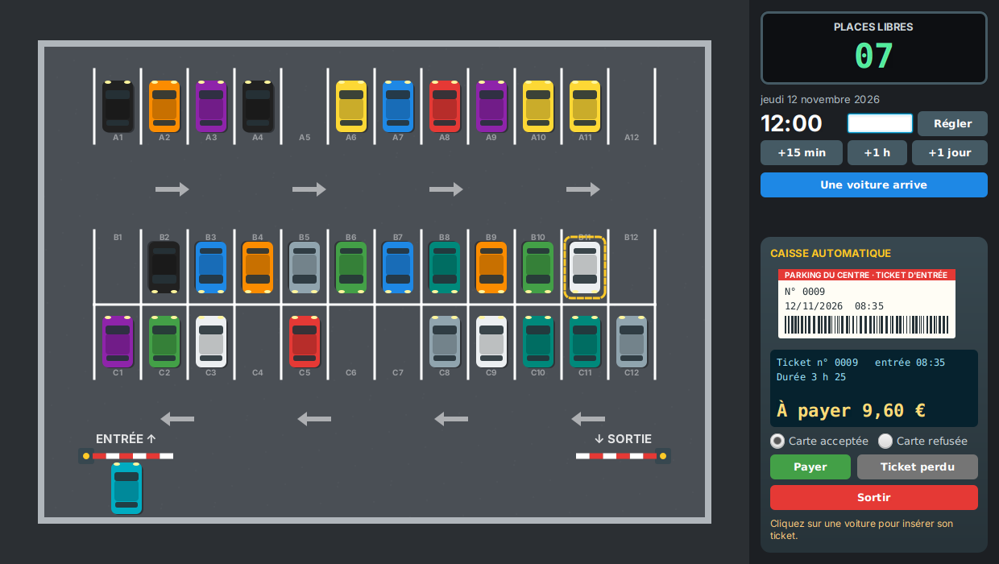

# Parking

Un parking à barrières : un ticket à l'entrée, un tarif selon la durée, une caisse automatique, et une barrière de sortie qui ne s'ouvre que si tout est payé.

Le code compile et l'application se lance… mais elle n'a **aucun test**, et elle contient **19 bugs**. Votre mission : les trouver en écrivant des tests, puis les corriger.

> **Règle d'or : pas de correction sans test rouge.**
> Pour chaque bug : 1) écrivez un test qui échoue, commit `BUG: …` ; 2) corrigez, le test passe, commit `FIX: …`.

## Démarrage

Prérequis : Java 21, Maven 3.9, un IDE. Toutes les commandes se lancent **dans le dossier `parking`**.

| Commande | Effet |
| --- | --- |
| `mvn javafx:run` | Lance l'application |
| `mvn test` | Lance les tests et produit le rapport de couverture `target/site/jacoco/index.html` |
| `mvn test -Dtest=TariffTest` | Lance une seule classe de test |
| `mvn test-compile org.pitest:pitest-maven:mutationCoverage` | Tests de mutation, rapport dans `target/pit-reports/index.html` |

Depuis un IDE, lancez `com.unittesting.parking.Launcher`. Un premier test est fourni : `MoneyTest`.

### L'application

- **Une voiture arrive** : un ticket est imprimé et la voiture se gare.
- Cliquez sur une voiture pour insérer **son ticket** dans la caisse : la durée et le montant dû s'affichent.
- L'**horloge** avance de 15 minutes, d'une heure ou d'un jour, ou se règle à une heure précise.
- La caisse permet de **payer** (la carte peut être acceptée ou refusée), de déclarer un **ticket perdu**, et de **sortir**.

## Le code

Tout ce qui est à tester est dans `com.unittesting.parking.model`, en Java pur (sans JavaFX). Le paquet `com.unittesting.parking.ui` est la fenêtre : inutile de le tester.

| Classe | Rôle | Dépendances à isoler |
| --- | --- | --- |
| `Money` | Affiche un montant en centimes (`960` → `"9,60 €"`) | aucune |
| `Tariff` | Le prix d'un stationnement entre deux instants | aucune |
| `Ticket` | Un ticket : numéro, heure d'entrée, paiements | aucune |
| `CarPark` | Le parking : entrée, caisse, sortie, places libres | `Clock`, `Barrier` (×2), `TicketPrinter`, `PaymentTerminal` (du matériel : à remplacer par des mocks) |

Tous les montants sont des `int` en **centimes**. Les dates sont des `ZonedDateTime` : le fuseau horaire compte (voir le changement d'heure). Placez vos tests dans le paquet `com.unittesting.parking.model`, sous `src/test/java`.

## Le cahier des charges

### Montants (`Money`)
- `Money.format` affiche les euros, une virgule, **toujours deux chiffres** de centimes, puis ` €` : `5` → `"0,05 €"`, `100` → `"1,00 €"`, `960` → `"9,60 €"`.

### Tarif (`Tariff.price(entrée, sortie)`)
- Un stationnement de **15 minutes ou moins** est gratuit (15 min 00 s comprises).
- Au-delà, **chaque heure entamée** est due : exactement 1 h → 1 heure ; 1 h et 1 seconde → 2 heures.
- Le prix d'une heure dépend de l'heure **à laquelle elle commence** : **1,00 €** la nuit (de **20:00 à 07:59**), **2,40 €** le jour (de 08:00 à 19:59). Exemple : entrée à 19:30, sortie à 21:30 → 2,40 € + 1,00 € = 3,40 €.
- Chaque **période de 24 heures entamée**, comptée depuis l'entrée, coûte **au plus 18,00 €**. Deux jours pile → 36,00 € ; deux jours et 30 minutes → 36,00 € + le prix de l'heure entamée.
- La durée est le temps **réellement écoulé** : la nuit du passage à l'heure d'été dure une heure de moins, celle du passage à l'heure d'hiver une heure de plus.

### Entrer (`CarPark.enter`)
- La capacité doit être strictement positive, sinon `IllegalArgumentException`.
- S'il reste une place : un ticket est créé (heure d'entrée = maintenant), **imprimé**, la **barrière d'entrée s'ouvre**, et il y a une place libre de moins.
- Les numéros de ticket valent 1, 2, 3… et ne sont **jamais réutilisés**.
- Parking complet : `Optional.empty()`, rien n'est imprimé, la barrière **reste fermée**.

### Montant dû (`CarPark.amountDue`)
- Dans les **15 minutes qui suivent un paiement** (15 min 00 s comprises) : 0.
- Sinon : le tarif depuis l'entrée **moins ce qui a déjà été payé** (jamais négatif). Un conducteur qui a payé puis tardé paie donc seulement le complément.

### Payer (`CarPark.pay`)
- Un ticket déjà utilisé pour sortir ne peut plus être payé : `IllegalStateException`.
- Rien à payer (stationnement gratuit) : le ticket est validé **sans solliciter le terminal**.
- Sinon le terminal est débité du montant dû. **Refusé** : `pay` renvoie `false` et le ticket n'est pas payé. **Accepté** : le paiement est enregistré (montant et heure).

### Ticket perdu (`CarPark.lostTicket`)
- Forfait de **25,00 €**, débité par le terminal. Refusé : `Optional.empty()`.
- Accepté : un ticket de sortie (nouveau numéro) déjà payé, qui permet de sortir dans les 15 minutes.

### Sortir (`CarPark.exit`)
- La barrière s'ouvre si le montant dû est nul. Le ticket est alors **utilisé** (il ne fonctionne qu'une fois) et la **place est libérée**.
- Sinon (ou si le ticket a déjà servi) : `false`, la barrière reste fermée.

## Pour aller plus loin

- **Tests paramétrés** : le tarif est fait pour `@CsvSource` (entrée ; sortie ; prix attendu). Testez chaque borne : 15 minutes, l'heure pile, 20:00, 08:00, 24 heures.
- **Mocks** : barrières, imprimante et terminal sont du matériel. Vérifiez avec Mockito ce que le parking leur demande (`verify`, `times`, `never`, `verifyNoInteractions`).
- **Horloge** : `CarPark` lit l'heure dans une `Clock`. Écrivez une petite horloge de test que vous pouvez avancer (une classe qui hérite de `Clock`), en fuseau `Europe/Paris` pour tester le changement d'heure.
- **Mutation** : quand vos tests passent, lancez PIT.
