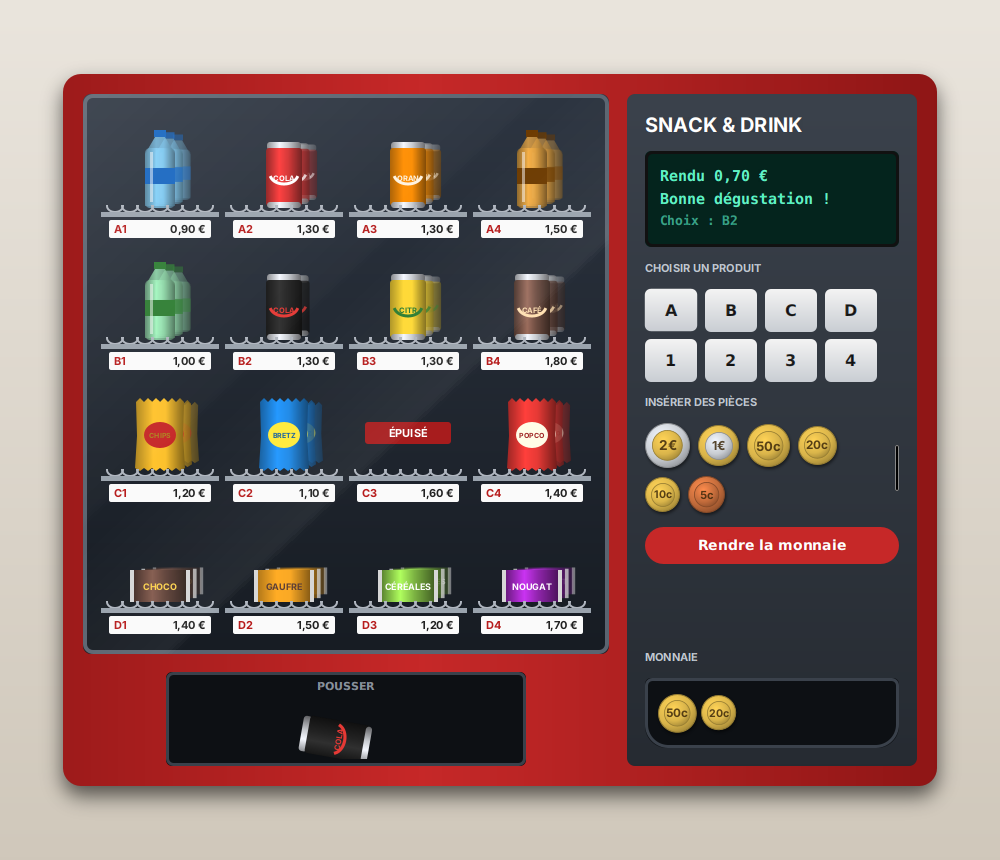

# Distributeur de boissons

A JavaFX vending machine: insert coins, type a product code (e.g. `B2`), get the product and the change.



## Run it

Requirements: JDK 17 or later and Maven.

```
mvn javafx:run
```

From an IDE, run `fr.tp.vending.Launcher`.

## How the code is organised

- `fr.tp.vending.model`: the machine's logic, plain Java with no JavaFX.
  - `ChangeCalculator` computes the coins to give back (a pure function).
  - `VendingMachine` handles credit, stock and purchases. It talks to the hardware only through
    three interfaces: `Display`, `CoinDispenser` and `ProductDispenser`. Tests can replace them with mocks.
- `fr.tp.vending.ui`: the window. `VendingApp` implements the three hardware interfaces.
